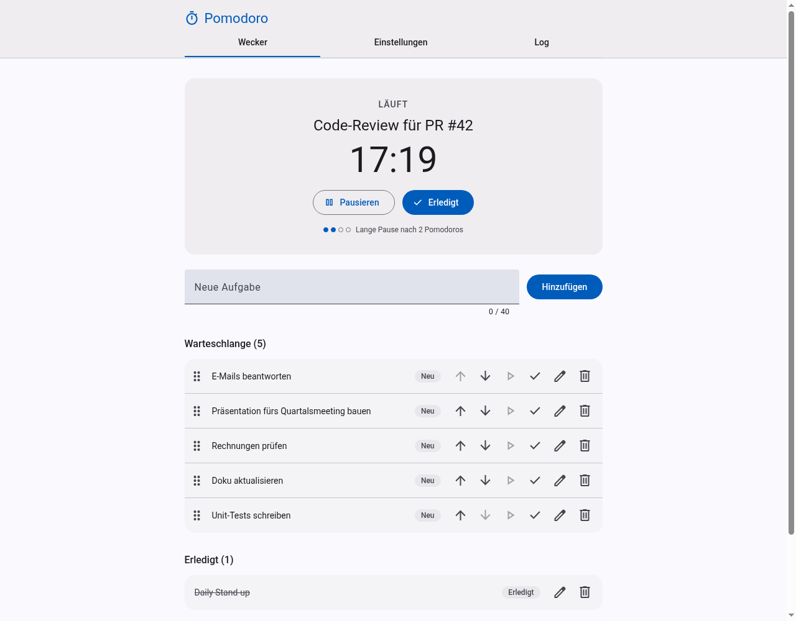
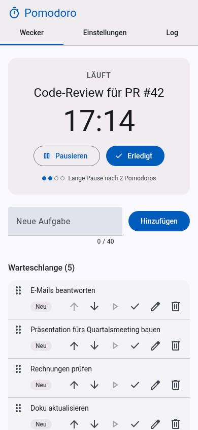
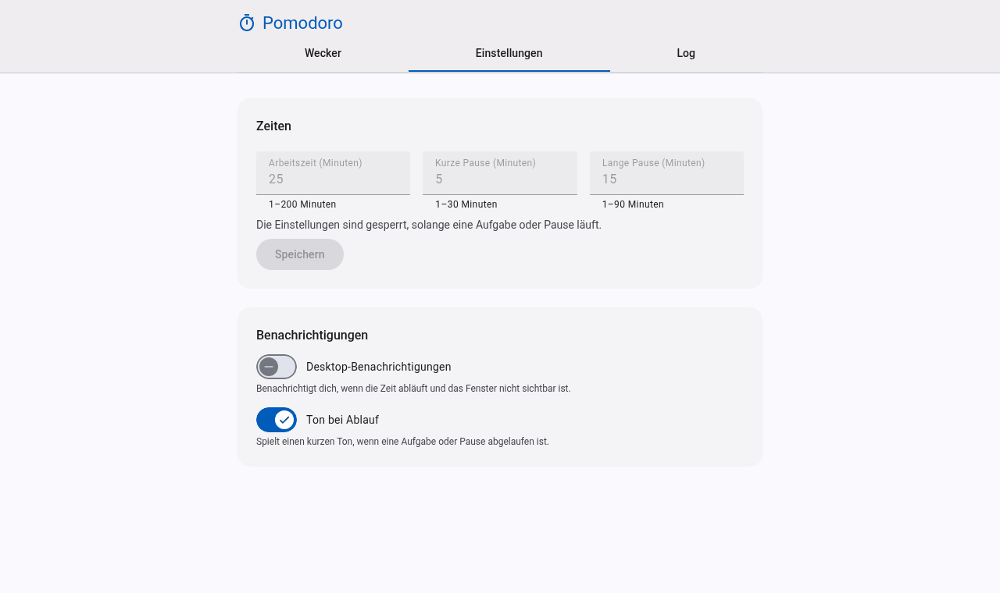
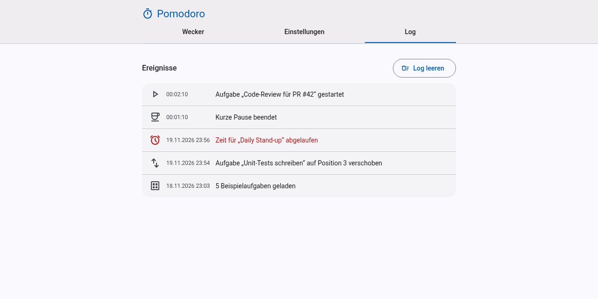

# Pomodoro

A Pomodoro timer with a task queue, built with current Angular (signals, zoneless, Signal Forms) and Angular Material.

**Live demo:** https://lucboillat.github.io/PomodoroTimer/

| Wecker (desktop)                                                                                                                     | Wecker (phone)                                                 |
| ------------------------------------------------------------------------------------------------------------------------------------ | -------------------------------------------------------------- |
|  |  |

| Einstellungen                                                                                      | Log                                                                   |
| -------------------------------------------------------------------------------------------------- | --------------------------------------------------------------------- |
|  |  |

## Features

**Wecker (timer)**

- A queue of tasks: add, rename, delete, start, pause, resume, complete.
- A large countdown for the active task or break, with the current phase and the position in the break cycle (●●○○ "Lange Pause nach 2 Pomodoros").
- Overdue tasks are marked in the panel and announced with a snackbar, a sound and (optionally) a desktop notification.
- Breaks start automatically after a pomodoro; every 4th break is a long one.
- Reorder waiting tasks by drag and drop or with up/down buttons.
- "Beispieldaten laden" adds sample tasks, "Alles zurücksetzen" resets everything after a confirmation dialog.

**Einstellungen (settings)**

- Duration of work periods, short and long breaks, validated (German messages).
- Locked, with an explanation, while a task or break is active.
- Toggles for desktop notifications and the alarm sound.

**Log**

- Every event (task added, started, overdue, moved, break over, settings changed, …), newest first, with time and an icon.

Everything is stored in `localStorage` and survives a reload, including a running countdown.

## Getting started

Requires Node.js 24 (as in CI).

```bash
npm ci
npm start              # dev server on http://localhost:4200
npm test -- --watch=false
npm run lint
npm run format:check
npm run build          # production build in dist/
```

## Interpretation of the ambiguous requirements

The brief leaves several points open. These are the interpretations, applied consistently throughout the app:

| Question                                             | Interpretation                                                                                                                                                                                                                                                                                                |
| ---------------------------------------------------- | ------------------------------------------------------------------------------------------------------------------------------------------------------------------------------------------------------------------------------------------------------------------------------------------------------------- |
| What is a "Wecker" relative to a task?               | The Wecker is a **queue of tasks**. Starting a task runs one work period (pomodoro) for it; the panel at the top shows the active task.                                                                                                                                                                       |
| Does "stop" mean pause or reset?                     | **Pause.** A paused task keeps its remaining time and can be resumed. Completing it is a separate action.                                                                                                                                                                                                     |
| When can settings be changed ("before the start")?   | **Whenever nothing is running:** settings are locked while a task is running or paused, or while a break is active. The reason is shown next to the disabled form. A change applies to the next pomodoro or break.                                                                                            |
| When does a timer become "overdue"?                  | **When its time has run out and it has not been completed.** Overdue is derived (`running` and `now ≥ endsAt`), not stored. An overdue task can only be completed, not paused.                                                                                                                                |
| Which tasks can be edited or deleted ("not active")? | Waiting and done tasks. Running and paused tasks are active and locked.                                                                                                                                                                                                                                       |
| Where do breaks fit in?                              | A break is a **timer phase, not a task.** It starts automatically when a _started_ task is completed (ticking off a waiting task gives no break). Every 4th break is long. A break can be ended early; starting the next task ends it too. When its time is up it shows "Pause vorbei" and stays until ended. |
| Which tasks can be reordered ("waiting tasks")?      | Only waiting tasks, so the list is split into **Warteschlange** and **Erledigt**; the active task is shown in the panel.                                                                                                                                                                                      |
| What does "reset everything" reset?                  | Tasks, break and break counter, settings and the log. The log then holds one entry, "Alles zurückgesetzt".                                                                                                                                                                                                    |

## Architecture

```
src/app/
  domain/       Framework-free TypeScript: Task, Break, Settings, AppEvent (Zod schemas + classes)
  core/         App-wide services without feature knowledge: Clock, EventBus,
                DesktopNotifications, AlarmSound, German Zod messages, page titles
  features/
    timer/      TaskStore, BreakStore, page + components, listeners (snackbar, desktop, sound)
    settings/   SettingsStore, settings page
    log/        LogStore, log page, German event texts
    app-reset.ts
  shared/       ConfirmDialog, formatDuration
```

### Domain layer

`Task`, `Break` and `Settings` are immutable classes with no Angular imports. Each has a Zod schema as the single source of truth for its shape, a private constructor and two factories: `create()` for user input and `parse()` for untrusted data such as `localStorage`. Business rules live here: `canEdit()`, `canDelete()`, `isOverdue(now)`, `remainingMs(now)`. Transitions (`start`, `pause`, `resume`, `complete`) return a new instance or throw an `InvalidTransitionError`; an invalid transition is never silently ignored.

### State: one signal store per feature

Each store is a root service with a private writable signal, a public read-only view (`asReadonly()`), `computed()` for derived state (`activeTask`, `queue`, `cycle`, …) and methods for commands. `effect()` is only used for side effects (saving to `localStorage`, showing notifications), never to derive state. No NgRx: at this size, plain signals are enough.

Persistence lives in the stores. Loading is defensive: invalid JSON, wrong types or a single broken entry fall back to defaults or are skipped, they never crash the app.

### Time: timestamps, not ticks

A running task stores `endsAt`, a paused one `remainingMs`. The `Clock` service only provides `now` as a signal that updates once per second; all times are computed from it (`endsAt - now`). This stays correct when the browser throttles timers in a background tab, and a reload restores the exact remaining time or the overdue state. Components receive `now` as an input, so tests pass in a fixed time.

### Events and the log

Stores emit typed events (`task-started`, `break-over`, …) on a small `EventBus`. Listeners react without the stores knowing about them:

```
TaskStore / BreakStore / SettingsStore / TimerNotifier
        │ emit
        ▼
     EventBus ──► LogStore           (log tab)
              ──► DesktopNotifier    (Notification API, only when the tab is hidden)
              ──► SoundNotifier      (Web Audio)
```

- The bus is a plain listener list, not a signal: signals hold state and coalesce, so two events in the same tick ("task completed" + "break started") would arrive as one.
- Time-based events (overdue, break over) are detected by the `TimerNotifier` from a `computed()` that only changes its value once per task or break, so they fire once, not on every tick.
- All listeners are started in `app.config.ts` (`provideAppInitializer`), because the tabs are lazy routes and would otherwise miss events.

### Forms

Signal Forms (`form()`, `validateStandardSchema()` with the domain's Zod schemas, `[formField]`). The settings lock uses `disabled(path, { when })`, which also provides the reason shown to the user. Validation messages are German through one global Zod error map (`core/zod-messages.ts`), so the domain stays free of UI text.

### UI and accessibility

- Angular Material 3, three lazy routes shown with `mat-tab-nav-bar`, so tabs are deep-linkable (`/timer`, `/settings`, `/log`).
- Responsive: content is centred and at most 720 px wide; on phones task rows wrap into two lines.
- German UI and `lang="de"`; page titles like "Wecker · Pomodoro".
- The countdown is `role="timer"` and is not read out every second; state changes are announced through a polite live region.
- Reordering also works by keyboard (up/down buttons keep the focus and announce the new position), as dragging alone excludes keyboard, screen reader and many motor-impaired users (WCAG 2.2, 2.5.7).
- Disabled controls say why they are disabled; the destructive reset asks for confirmation with focus on "Abbrechen".

## Tests

781 unit tests (Vitest) in 27 files, run in CI on every push.

- The domain and the stores are tested most thoroughly: every transition, the overdue boundary, edit/delete restrictions, the settings lock, the break rhythm, reordering, persistence round trips and corrupt storage.
- Components are tested through Angular Material's component harnesses, the way a user interacts with them.
- Browser APIs are replaced by fakes (`src/testing/`): the clock, `Notification` and `AudioContext`.
- Key behaviour was checked with mutation tests: temporarily breaking the code to confirm that a test fails.

## Bonuses

- [x] Settings persisted in `localStorage`
- [x] Tasks persisted in `localStorage` (including the running timer and the order)
- [x] Desktop notifications when the window is hidden (permission requested on a click; blocked and unsupported browsers are handled)
- [x] Reorder waiting tasks by drag and drop and with up/down buttons

Additionally: the log is persisted too, an alarm sound, the break-cycle indicator, sample data, and a GitHub Actions pipeline that lints, tests, builds and deploys to GitHub Pages.

## Decisions and trade-offs

- **Fully signal-based and zoneless.** No zone.js, no `BehaviorSubject` stores. RxJS only appears where Angular Material returns an observable: the dialog's `afterClosed()` (bridged with `firstValueFrom`) and the snackbar's `onAction()`.
- **Zod** for validation: one schema per domain type gives the TypeScript types, validates `localStorage` data and drives the Signal Forms validators.
- **One deliberate `detectChanges()`.** After a drop, the CDK puts the dragged element back at its old place in the DOM; without zone.js Angular re-renders a frame later, which showed as a flash. The drop handler renders the list synchronously instead.
- **`localStorage` is accessed directly in the stores**, without a `StorageService` abstraction or a schema version. Defensive loading covers missing and corrupt data; a storage abstraction and versioned migrations would be the next step once the data format changes.
- **Desktop notifications only when the tab is hidden**, as specified. A window that is merely covered by another program still counts as visible to the browser, so in that case only the snackbar and the sound appear.
- **Overdue after reopening the browser:** the log records an overdue task when the app notices it. If the browser was closed when the time ran out, that is the next time the app is opened.

## What would come next

- **Bundle size:** the initial bundle is about 977 kB (211 kB compressed) and above Angular's default warning budget of 500 kB. Candidates: `zod/mini`, and starting fewer services eagerly.
- A `StorageService` behind an `InjectionToken`, with a schema version and migrations.
- Syncing between several open tabs via the `storage` event.
- A Playwright smoke test of the whole chain: add task → start → overdue → appears in the log.
- Dark mode, and notifications on Android (they require a service worker there).
